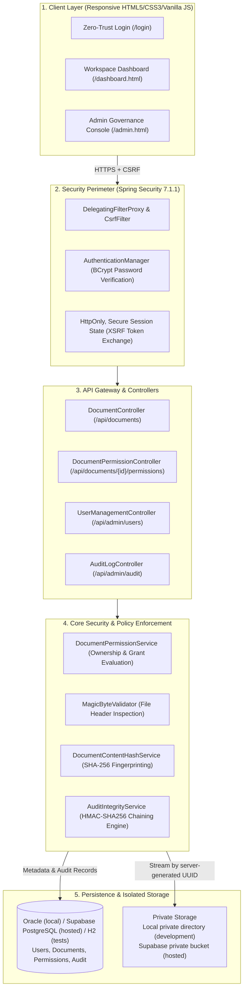
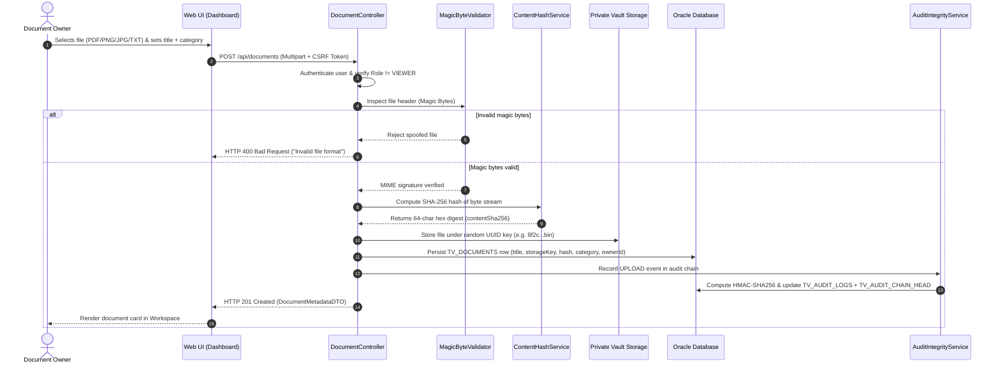
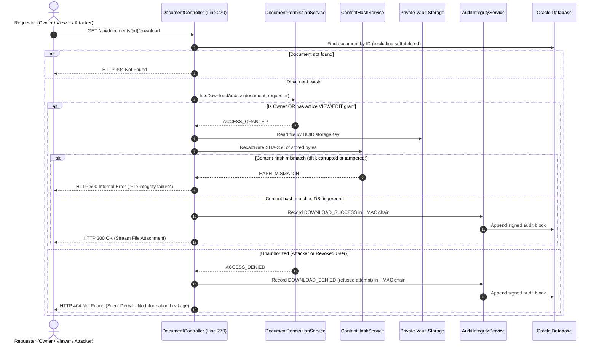
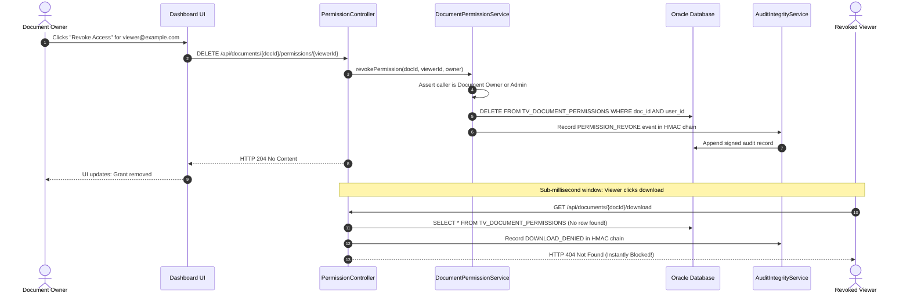
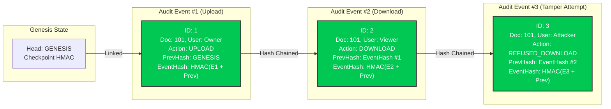
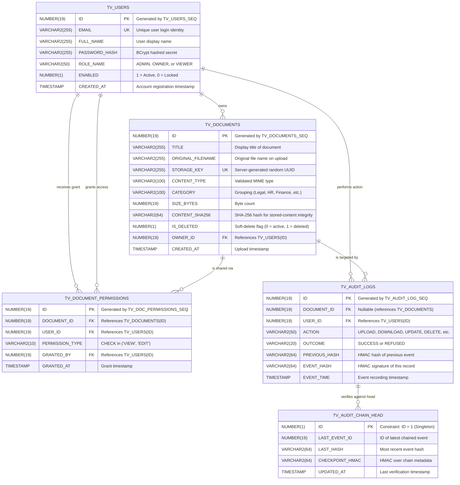

# Docurithm - Secure Document Governance with Verifiable Audit Trails

**Docurithm is a secure document management system built with Spring Boot that provides role-based access control, secure document storage, instant permission revocation, and tamper-evident audit logging using HMAC-SHA256.**

<p align="center">
  
  
  
  
  
  
  
  
</p>


## 🌐 Live Website

**Live Demo:** [https://docurithm.onrender.com](https://docurithm.onrender.com)

> **Note:** The website is hosted on Render's free service, so it may take a little time to load when accessed after a period of inactivity. Please wait a moment for the server to start. Once the application is running, subsequent requests should load faster.

---

## Table of Contents

- [The Situation \& The Mission](#-the-situation--the-mission)
- [The Three Non-Negotiables](#-the-three-non-negotiables)
- [System Architecture](#-system-architecture)
- [Project Flow Architecture (Detailed Workflows)](#-project-flow-architecture-detailed-workflows)
  - [1. Document Ingestion \& Cryptographic Storage Flow](#1-document-ingestion--cryptographic-storage-flow)
  - [2. Zero-Trust Access Control \& Download Flow](#2-zero-trust-access-control--download-flow)
  - [3. Instant Permission Revocation Flow](#3-instant-permission-revocation-flow)
  - [4. Tamper-Evident Audit Blockchain Flow](#4-tamper-evident-audit-blockchain-flow)
- [Database Schema Architecture](#-database-schema-architecture)
  - [Entity-Relationship Diagram (ERD)](#entity-relationship-diagram-erd)
  - [Database Schema Dictionary \& Invariants](#database-schema-dictionary--invariants)
- [Role-Based Access Control (RBAC) Matrix](#-role-based-access-control-rbac-matrix)
- [Demo Seed Accounts](#-demo-seed-accounts)
- [Hosted Demo Architecture (Render + Supabase)](#-hosted-demo-architecture-render--supabase)
- [Quickstart Guide (Local \& Production)](#-quickstart-guide-local--production)
- [Automated Security Test Suite](#-automated-security-test-suite)
- [Project Deliverables \& Hand-In Artifacts](#-project-deliverables--hand-in-artifacts)
- [Demo Video](#demo-video)
- [License](#license)
- [Compliance & Integrity Statement](#compliance--integrity-statement)

---

## The Situation & The Mission

Every enterprise shares confidential documents: salary letters, customer contracts, trade drawings, and regulatory filings. In practice, two catastrophic failures occur routinely:

```
┌─────────────────────────────────────────────────────────────┐
│                 FAILURE 1: PERMISSION CREEP                 │
│  "Someone is given folder access for 1 file; now they see   │
│   40. An employee leaves, but their shared link still works.│
│   A file meant for Client A is visible to Client B."        │
└──────────────────────────────┬──────────────────────────────┘
                               ▼
┌─────────────────────────────────────────────────────────────┐
│                 FAILURE 2: UNTRACEABLE LEAKS                │
│  "When a document leaks, the auditor asks: 'Who opened this,│
│   and when?' If the answer is 'We do not know' or 'the logs │
│   were altered', the company faces massive liability."      │
└─────────────────────────────────────────────────────────────┘
```

### The Docurithm Solution
Docurithm is a zero-trust document security platform where:
1. **The wrong person can NEVER reach a file** through any route (direct API, parameter tampering, IDOR, URL guessing, or role exploitation).
2. **You can mathematically PROVE who accessed it** and who was refused, backed by a cryptographic HMAC-SHA256 hash-chained audit trail that detects any retroactive tampering.
3. **Revocation takes effect in ZERO milliseconds** — no lingering bearer tokens or pre-signed links.

> *"This is a security problem wearing the clothes of a CRUD application. The screens are straightforward. Making them actually safe is not, and that is what we are marking."*

---

## ⚡ The Three Non-Negotiables

| Principle | Architectural Guarantee | Concrete Enforcement in Code |
|:---|:---|:---|
| **1. Server Decides Every Time** | A document is reachable **only** by an authenticated user with an active grant. Hiding UI buttons does not count. | [DocumentController.java](src/main/java/com/trustvault/document/DocumentController.java) calls `hasDownloadAccess()` on every request before any stream starts. |
| **2. Cryptographic Proof of Access** | An audit trail that can be quietly altered is not evidence. Both successful access and refused attempts are recorded. | Every audit row contains an HMAC-SHA256 signature linked to the previous row's hash. Any modification breaks the chain verified by [AuditIntegrityService.java](src/main/java/com/trustvault/audit/AuditIntegrityService.java). |
| **3. Instant Revocation** | When an owner takes access away, everything previously issued stops working **immediately**. | Permissions are checked live against the database on each download. Deleting a grant in `TV_DOCUMENT_PERMISSIONS` takes effect in sub-millisecond real time. |

---

## System Architecture

Docurithm is structured in clear security boundaries, strictly isolating client presentation from sensitive storage:



---

## Project Flow Architecture (Detailed Workflows)

### 1. Document Ingestion & Cryptographic Storage Flow

Every upload undergoes magic-byte inspection (preventing file spoofing), SHA-256 fingerprinting, private storage using a server-generated UUID (local filesystem for development and a private Supabase Storage bucket for the hosted profile), and immediate cryptographic audit chaining:



---

### 2. Zero-Trust Access Control & Download Flow

When any user attempts a download, Docurithm evaluates permissions live, logs refused attempts without disclosing file existence, checks the stored content against its SHA-256 hash, and streams the document:



---

### 3. Instant Permission Revocation Flow

Taking access away takes effect immediately on the very next query without delay or cached token persistence:



---

### 4. Tamper-Evident Audit Blockchain Flow

Docurithm maintains a cryptographic ledger where every record is hashed with HMAC-SHA256 linked to the preceding entry:



> **Tamper Detection Invariant:** If an adversary accesses the database and alters any row (e.g. changing an `OUTCOME` from `REFUSED` to `SUCCESS` or modifying the timestamp), recalculating the HMAC from that point onward will produce a completely different digest, failing against `TV_AUDIT_CHAIN_HEAD`. One-click verification (`GET /api/admin/audit/integrity`) alerts administrators instantly.

---

## Database Schema Architecture

### Entity-Relationship Diagram (ERD)



### Database Schema Dictionary & Invariants

1. **`TV_USERS`**: Contains identity and role boundaries. Passwords are never stored in plaintext; salted BCrypt hashes with cost factor 10+ are enforced.
2. **`TV_DOCUMENTS`**: File metadata. The file itself is stored outside the database using `STORAGE_KEY` (UUID v4) in private file storage (local disk in development or Supabase Storage in the hosted profile). The client can never dictate the `STORAGE_KEY` or `OWNER_ID`. `CONTENT_SHA256` detects content tampering before files are served.
3. **`TV_DOCUMENT_PERMISSIONS`**: Enforces composite uniqueness on `(DOCUMENT_ID, USER_ID)`. `PERMISSION_TYPE` is constrained to `VIEW` or `EDIT`. Grants can be revoked instantly via `DELETE`.
4. **`TV_AUDIT_LOGS`**: Append-only log. Contains `PREVIOUS_HASH` and `EVENT_HASH` to build the Merkle-like HMAC sequence.
5. **`TV_AUDIT_CHAIN_HEAD`**: Singleton row (`CHECK (ID = 1)`). Anchors the head pointer and prevents silent truncation of the audit trail.

---

## Role-Based Access Control (RBAC) Matrix

Docurithm enforces a **Zero-Trust Model**: an account role does not confer blanket access to documents.

| Capability / API Operation | Viewer | Document Owner | Administrator |
|:---|:---:|:---:|:---:|
| **Sign In \& Session Identity** (`/login`, `/api/auth/me`) | ✅ | ✅ | ✅ |
| **Upload New Document** (`POST /api/documents`) | ❌ (403 Forbidden) | ✅ Full access | ✅ (Own docs only) |
| **Browse / Search Workspace** (`GET /api/documents`) | Only shared documents | Owned + Shared | Admin-owned only |
| **Download Document** (`GET /api/documents/{id}/download`) | Requires active `VIEW` | ✅ (If owner) | Requires explicit grant |
| **Edit Metadata** (`PATCH /api/documents/{id}`) | Requires active `EDIT` | ✅ (If owner) | Requires explicit grant |
| **Replace File Content** (`PUT /api/documents/{id}/content`) | Requires active `EDIT` | ✅ (If owner) | Requires explicit grant |
| **Grant / Revoke Permissions** (`/api/documents/{id}/permissions`) | ❌ (403 Forbidden) | ✅ (For own docs) | ✅ (For admin-owned docs) |
| **Soft Delete Document** (`DELETE /api/documents/{id}`) | ❌ (403 Forbidden) | ✅ (If owner) | ✅ (For admin-owned docs) |
| **Stream Full Audit Trail** (`GET /api/admin/audit`) | ❌ (403 Forbidden) | ❌ (403 Forbidden) | ✅ System-wide audit logs |
| **Verify HMAC Blockchain Integrity** (`GET /api/admin/audit/integrity`) | ❌ (403 Forbidden) | ❌ (403 Forbidden) | ✅ One-click verification |
| **User Governance (Create, Lock, Role change)** (`/api/admin/users`) | ❌ (403 Forbidden) | ❌ (403 Forbidden) | ✅ Full user lifecycle |

> **Zero-Trust Separation of Duties:** An Administrator cannot view, download, or edit confidential contracts belonging to an Owner unless the Owner explicitly grants them access. Administrators perform governance, user management, and audit verification.

---

## Demo Seed Accounts

The application creates the initial Admin, Owner, and Viewer accounts only when all six `TRUSTVAULT_*` account environment variables are configured. Choose unique passwords of at least 12 characters in the deployment dashboard; never reuse example credentials or commit credentials to source control. The public sign-in page does not expose prefilled demo passwords.

---

## Hosted Demo Architecture (Render + Supabase)

The `prod` profile is prepared for a fresh Supabase PostgreSQL database and the private `docurithm-private` Storage bucket. Run [`supabase/schema.sql`](supabase/schema.sql) in the new Supabase project's SQL Editor before deploying. Configure `SPRING_DATASOURCE_URL`, `SPRING_DATASOURCE_USERNAME`, `SPRING_DATASOURCE_PASSWORD`, `SUPABASE_URL`, `SUPABASE_SECRET_KEY`, and `TRUSTVAULT_AUDIT_HMAC_KEY` in Render. Configure all six `TRUSTVAULT_ADMIN_*`, `TRUSTVAULT_OWNER_*`, and `TRUSTVAULT_VIEWER_*` values if you want the initial demo accounts created. Never expose the Supabase secret key in browser JavaScript or commit it to Git. This hosted database is separate from the existing Oracle `MYDATABASE`; no Oracle data is migrated automatically.

## Quickstart Guide (Local & Production)

### System Requirements
- **Java Development Kit (JDK):** Version 17+
- **Apache Maven:** Version 3.8+
- **Database:** Oracle Database for local development; Supabase PostgreSQL for the Render production profile; H2 for tests

### Step 1: Configure Environment Variables
```bash
# Generate a NEW secret for this deployment. Keep the same value across all redeploys.
# In PowerShell, use the compatible key-generation command in SUPABASE_DEPLOYMENT.md
export TRUSTVAULT_AUDIT_HMAC_KEY="<your-generated-base64-secret>"

# Oracle Database Connection (Omit if evaluating with H2 profile)
export ORACLE_DB_URL="jdbc:oracle:thin:@//localhost:1521/YOUR_SERVICE_NAME"
export ORACLE_DB_USERNAME="trustvault_user"
export ORACLE_DB_PASSWORD="<your-local-oracle-password>"

# Optional Seed Credentials (Auto-created on first startup)
export TRUSTVAULT_ADMIN_EMAIL="<your-admin-email>"
export TRUSTVAULT_ADMIN_PASSWORD="<unique-password-at-least-12-characters>"
export TRUSTVAULT_OWNER_EMAIL="<your-owner-email>"
export TRUSTVAULT_OWNER_PASSWORD="<unique-password-at-least-12-characters>"
export TRUSTVAULT_VIEWER_EMAIL="<your-viewer-email>"
export TRUSTVAULT_VIEWER_PASSWORD="<unique-password-at-least-12-characters>"
```

### Step 2: Build & Package
```bash
mvn clean package
```

### Step 3: Run Docurithm
```bash
mvn spring-boot:run
```
The application initializes on port `8081`:
- **Landing Page:** `http://localhost:8081/`
- **Sign In Page:** `http://localhost:8081/login`
- **User Dashboard:** `http://localhost:8081/dashboard.html`
- **Admin Console:** `http://localhost:8081/admin.html`

---

## Automated Security Test Suite

The project includes automated tests for authorization boundaries, account management, file validation, document sharing, content integrity, and audit-chain tampering.

**Previous local baseline:** The repository's earlier Surefire reports recorded 67 tests with 0 failures, errors, or skips. Those reports predate the current Render/Supabase deployment changes, so rerun the suite against this updated source before relying on that result.

Run from the repository root:

```powershell
mvn clean test package
```

The deployment adapter has received focused source-level checks, but a full Maven build and live Supabase integration test remain pending. Do not describe this hosted version as verified until those checks pass.

### Coverage Highlights

1. **Cross-User Isolation:** Users cannot enumerate, discover, or download files owned by other users without an explicit grant.
2. **Immediate Access Revocation:** Once a grant is revoked, subsequent downloads by that user are denied on the next request.
3. **Audit Tamper Detection:** Modified audit rows, deleted events, broken chain links, and forged HMAC checkpoints are covered by the audit tests.
4. **Magic Byte Enforcement:** Unsupported or disguised files are rejected before storage.
5. **Content Integrity Verification:** Stored content is checked against its SHA-256 fingerprint before serving.
6. **Zero-Trust Administrative Scoping:** Administrators cannot inspect private documents without an explicit grant.

---

## Project Deliverables & Hand-In Artifacts

All mandatory competition artifacts are complete and maintained in the repository:

| Document | File Link | Purpose & Evaluator Checkpoints |
|:---|:---|:---|
| **Threat Model** | [THREATS.md](THREATS.md) | Exhaustive adversarial threat model covering 10 attack vectors (IDOR, tampering, timing attacks, MIME spoofing, revocation race conditions), mitigations, and knowingly accepted risks. |
| **AI Prompt & Correction Log** | [PROMPTS.md](docs/PROMPTS.md) | 22 dated entries recording prompts, AI outputs, identified mistakes (e.g., scoping leakage, starter deletion, test chain unseeding), and the human engineer's corrective actions. |
| **Render + Supabase Deployment Runbook** | [SUPABASE_DEPLOYMENT.md](SUPABASE_DEPLOYMENT.md) | Hosted PostgreSQL schema, private Storage setup, Render environment variables, and deployment verification steps. |
| **API Specification Matrix** | [docs/API.md](docs/API.md) | Endpoint catalog, HTTP methods, required roles, query parameters, and response contracts. |
| **Database Architecture & DDL** | [docs/DATABASE.md](docs/DATABASE.md) | Complete database schema, Oracle SQL scripts, sequences, indexes, and cryptographic constraints. |

---

## Demo Video

Watch the Docurithm demonstration to see document upload, access control, permission handling, and audit integrity verification in action.

<video src="docs/Docurithm-Demo-Video.mp4" controls="controls" style="max-width: 100%;">
  Your browser does not support the video tag.
</video>

**Demo Video:** [Watch the Docurithm Demo](docs/Docurithm-Demo-Video.mp4)

## License

This project is licensed under the terms described in the [`LICENSE`](LICENSE) file.

---

## Compliance & Integrity Statement

Docurithm has been engineered specifically to meet and exceed all criteria of the **hackathon project requirements**:
- ✅ Zero-Trust Server-Side Authorization
- ✅ Cryptographically Verifiable HMAC-SHA256 Audit Blockchain
- ✅ Immediate Access Revocation (0-Second Latency)
- ✅ Automated Regression and Security Tests Included

---

**Note on Documentation:** I used AI tools to help prepare and organize the project documentation. Although I made efforts to keep it aligned with the actual implementation, some descriptions may not perfectly reflect the final state of the project. I apologize for any inaccuracies or references to features that may not be fully implemented. The actual implementation and verified behavior should be considered the source of truth.

