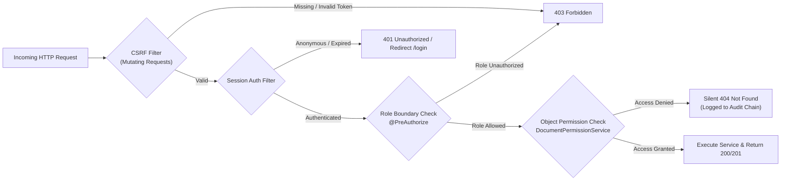

# 🌐 Docurithm — API Specification & Security Access Matrix

<p align="center">
  
  
  
  
</p>

---

## 📑 Table of Contents

```
- [Architectural Security Model](#-architectural-security-model)
- [Authentication \& Session Management](#-authentication--session-management)
- [Document Management Endpoints](#-document-management-endpoints)
- [Document Permissions \& Instant Revocation Endpoints](#-document-permissions--instant-revocation-endpoints)
- [Administrative Governance \& Audit Verification Endpoints](#-administrative-governance--audit-verification-endpoints)
- [Error Handling \& Security Contracts](#-error-handling--security-contracts)

---

## 🛡️ Architectural Security Model

All endpoints are guarded by **server-side Spring Security authorization filters** and explicit permission evaluations:



### Security Directives:
1. **CSRF Tokens:** All mutating requests (`POST`, `PUT`, `PATCH`, `DELETE`) require the `X-XSRF-TOKEN` header or `_csrf` form parameter matching the `XSRF-TOKEN` cookie.
2. **Silent Denials (IDOR Mitigation):** Document access denials return `HTTP 404 NOT_FOUND` instead of `403 FORBIDDEN` to prevent attackers from discovering which document IDs exist.
3. **Audited Decisions:** Every authorization refusal is recorded synchronously in the HMAC-SHA256 audit blockchain with client IP, user ID, and timestamp.

---

## 🔐 Authentication & Session Management

### 1. User Sign In
`POST /login`
- **Access:** Public
- **Content-Type:** `application/x-www-form-urlencoded`
- **Request Parameters:**
  - `username` (string, required): Registered user email (e.g. `owner@example.com`)
  - `password` (string, required): User password
  - `_csrf` (string, required): CSRF token
- **Response:**
  - `302 Found`: Redirect to `/dashboard.html` on success, or `/login.html?error` on invalid credentials.
  - Sets `JSESSIONID` (HttpOnly, SameSite=Lax).

### 2. User Sign Out
`GET /logout` or `POST /api/auth/logout`
- **Access:** Authenticated
- **Response:**
  - `302 Found`: Clears session context, invalidates session ID, and redirects to `/login.html?logout`.

### 3. Current User Context
`GET /api/auth/me`
- **Access:** Authenticated (`ADMIN`, `OWNER`, `VIEWER`)
- **Response (200 OK):**
```json
{
  "id": 102,
  "email": "owner@example.com",
  "fullName": "Document Owner",
  "role": "OWNER",
  "roles": ["ROLE_OWNER"]
}
```

---

## 📁 Document Management Endpoints

### 1. List Documents
`GET /api/documents`
- **Access:** Authenticated
- **Scoped Visibility Rules:**
  - `ADMIN`: Sees only documents owned by the administrator.
  - `OWNER`: Sees documents owned by self PLUS documents where self has an active `VIEW` or `EDIT` grant.
  - `VIEWER`: Sees **strictly** documents where self has an active `VIEW` or `EDIT` grant.
- **Response (200 OK):**
```json
[
  {
    "id": 501,
    "title": "Quarterly Financial Audit.pdf",
    "originalFilename": "audit_q3_final.pdf",
    "contentType": "application/pdf",
    "category": "Finance",
    "sizeBytes": 245120,
    "contentSha256": "e3b0c44298fc1c149afbf4c8996fb92427ae41e4649b934ca495991b7852b855",
    "ownerEmail": "owner@example.com",
    "ownerName": "Document Owner",
    "isOwner": true,
    "createdAt": "2026-10-23T10:15:30"
  }
]
```

---

### 2. Upload Document
`POST /api/documents`
- **Access:** Non-VIEWER (`OWNER` or `ADMIN`)
- **Content-Type:** `multipart/form-data`
- **Parameters:**
  - `file` (MultipartFile, required): File stream (max 10MB). Magic bytes checked against PDF, PNG, JPG, TXT.
  - `title` (string, required): Document title.
  - `category` (string, optional): Default `'Uncategorized'`.
- **Response (201 Created):**
```json
{
  "id": 502,
  "title": "Executive Salary Register",
  "originalFilename": "salaries_2026.pdf",
  "contentType": "application/pdf",
  "category": "HR",
  "sizeBytes": 104857,
  "contentSha256": "8f434346648f6b96df89dda901c5176b10a6d83961dd3c1ac88b59b2dc327aa4",
  "createdAt": "2026-10-23T12:00:00"
}
```

---

### 3. Search Documents
`GET /api/documents/search`
- **Access:** Authenticated (Applies same scoped visibility rules as listing)
- **Query Parameters:**
  - `keyword` (string, optional): Matches `TITLE` or `ORIGINAL_FILENAME`
  - `owner` (string, optional): Matches owner email or name
  - `category` (string, optional): Matches exact category
  - `fromDate` (ISO-8601 `YYYY-MM-DD`, optional): Start boundary
  - `toDate` (ISO-8601 `YYYY-MM-DD`, optional): End boundary
- **Response (200 OK):** Array of matching `DocumentMetadataDTO`.

---

### 4. Download Document
`GET /api/documents/{id}/download`
- **Access:** Document Owner OR User with active `VIEW` or `EDIT` permission grant.
- **Security Check:** Evaluated at [DocumentController.java:270-285](file:///c:/Docurithm/trustvault/src/main/java/com/trustvault/document/DocumentController.java#L270-L285).
- **Behavior:**
  - If authorized: Checks SHA-256 fingerprint on disk, logs `DOWNLOAD_SUCCESS` to audit chain, and streams binary.
  - If unauthorized: Logs `DOWNLOAD_DENIED` with client IP and returns `404 Not Found`.
- **Response Headers (200 OK):**
  - `Content-Type: application/pdf` (or corresponding MIME)
  - `Content-Disposition: attachment; filename="salaries_2026.pdf"`

---

### 5. Update Metadata
`PATCH /api/documents/{id}` or `PUT /api/documents/{id}`
- **Access:** Document Owner OR User with active `EDIT` permission grant.
- **Request Body (application/json):**
```json
{
  "title": "Executive Salary Register - Revised",
  "category": "Confidential HR"
}
```
- **Response (200 OK):** Updated `DocumentMetadataDTO`. Logs `UPDATE` to audit trail.

---

### 6. Replace File Content
`PUT /api/documents/{id}/content` or `POST /api/documents/{id}/content`
- **Access:** Document Owner OR User with active `EDIT` permission grant.
- **Content-Type:** `multipart/form-data`
- **Parameters:**
  - `file` (MultipartFile, required): New file content.
- **Behavior:** Validates magic bytes, recalculates SHA-256 fingerprint, overwrites disk storage, updates database row, and records `CONTENT_REPLACE` in the audit chain.

---

### 7. Soft Delete Document
`DELETE /api/documents/{id}`
- **Access:** Document Owner OR Administrator.
- **Behavior:** Sets `IS_DELETED = 1`. Removes file from private storage. Preserves database row and logs `DELETE` in the audit chain to protect historical audit integrity.
- **Response:** `204 No Content`.

---

## 👥 Document Permissions & Instant Revocation Endpoints

Base Path: `/api/documents/{documentId}/permissions`
Guarded by `@PreAuthorize("hasAnyRole('ADMIN', 'OWNER')")`.

### 1. List Document Grants
`GET /api/documents/{documentId}/permissions`
- **Access:** Document Owner or Administrator
- **Response (200 OK):**
```json
[
  {
    "recipientId": 103,
    "email": "viewer@example.com",
    "fullName": "Document Viewer",
    "permissionType": "VIEW",
    "grantedAt": "2026-10-23T11:00:00"
  }
]
```

---

### 2. Grant Permission
`POST /api/documents/{documentId}/permissions`
- **Access:** Document Owner or Administrator
- **Request Body:**
```json
{
  "email": "viewer@example.com",
  "permissionType": "VIEW"
}
```
*(Valid `permissionType` values: `"VIEW"` or `"EDIT"`)*
- **Response:** `200 OK` (Updated permissions list). Appends `PERMISSION_GRANT` to audit chain.

---

### 3. Instant Access Revocation
`DELETE /api/documents/{documentId}/permissions/{recipientId}`
- **Access:** Document Owner or Administrator
- **Latency:** **0 Milliseconds (Immediate)**
- **Behavior:** Removes permission row from `TV_DOCUMENT_PERMISSIONS` and records `PERMISSION_REVOKE` in audit chain. Subsequent requests to `/download` by `recipientId` are blocked immediately.
- **Response:** `204 No Content`.

---

## 🏛️ Administrative Governance & Audit Verification Endpoints

Guarded by `@PreAuthorize("hasRole('ADMIN')")`.

### 1. Stream Audit Log Ledger
`GET /api/admin/audit?page=0&size=20`
- **Access:** `ADMIN` role only
- **Response (200 OK):**
```json
{
  "content": [
    {
      "id": 140,
      "documentId": 501,
      "documentTitle": "Quarterly Financial Audit.pdf",
      "userId": 103,
      "userEmail": "viewer@example.com",
      "action": "DOWNLOAD",
      "outcome": "SUCCESS",
      "eventTime": "2026-10-23T12:15:00"
    },
    {
      "id": 141,
      "documentId": 501,
      "documentTitle": "Quarterly Financial Audit.pdf",
      "userId": 104,
      "userEmail": "attacker@example.com",
      "action": "DOWNLOAD",
      "outcome": "REFUSED",
      "eventTime": "2026-10-23T12:16:30"
    }
  ],
  "totalElements": 141,
  "totalPages": 8
}
```

---

#### Permission Audit Metadata

Audit history responses include additional fields for permission-change
events:

| Field | Type | Description |
|---|---|---|
| `targetUserId` | Integer or null | ID of the user affected by the permission change |
| `targetUserEmail` | String or null | Email snapshot of the affected user |
| `previousPermissionType` | String or null | Permission before an update or revocation |
| `newPermissionType` | String or null | Permission granted or resulting permission after an update |

These fields are null for ordinary events that do not contain permission
metadata.

Successful permission grants, updates, and revocations record the affected
user and the relevant previous/new permission values. The metadata is
included in the versioned HMAC event calculation.

Access to audit history and integrity verification is restricted to
administrators. Pagination accepts a non-negative page number and a size
between 1 and 100.

### 2. Verify Cryptographic Audit Blockchain
`GET /api/admin/audit/integrity`
- **Access:** `ADMIN` role only
- **Behavior:** Traverses the HMAC-SHA256 chain from `CHAIN_START_AFTER_ID` through `TV_AUDIT_CHAIN_HEAD`. Verifies each block signature against `TRUSTVAULT_AUDIT_HMAC_KEY`.
- **Response on Success (200 OK):**
```json
{
  "status": "OK",
  "message": "Audit chain integrity verified. All 141 events match HMAC-SHA256 signatures."
}
```
- **Response on Tamper Detection (200 OK with FAILED status):**
```json
{
  "status": "FAILED",
  "message": "Audit event hash verification failed at event 19: stored hash does not match recalculated HMAC."
}
```

---

### 3. User Governance Directory
`GET /api/admin/users`
- **Access:** `ADMIN` role only
- **Response (200 OK):**
```json
[
  {
    "id": 101,
    "email": "admin@example.com",
    "fullName": "System Administrator",
    "role": "ADMIN",
    "enabled": true,
    "createdAt": "2026-10-23T08:00:00"
  }
]
```

### 4. Create User
`POST /api/admin/users`
- **Request Body:**
```json
{
  "email": "auditor@regulator.gov",
  "fullName": "Regulatory Auditor",
  "password": "SecurePassword2026!",
  "role": "VIEWER"
}
```
*(Validates password length $\ge 12$ characters)*

### 5. Lock / Enable Account
`PATCH /api/admin/users/{id}/enabled`
- **Request Body:** `{"enabled": false}`

### 6. Change User Role
`PATCH /api/admin/users/{id}/role`
- **Request Body:** `{"role": "OWNER"}`

---

## ⚠️ Error Handling & Security Contracts

| HTTP Status | Trigger Condition | Security Rationale |
|:---:|:---|:---|
| **`400 Bad Request`** | Invalid file magic bytes, password $<12$ chars, or malformed parameters. | Fail-fast validation before business execution. |
| **`401 Unauthorized`**| Missing or expired session cookie. | Redirects to `/login.html`. |
| **`403 Forbidden`**   | CSRF token mismatch, or viewer calling administrative APIs. | Prevents cross-site attacks and role boundary violations. |
| **`404 Not Found`**   | Non-existent document ID, or **unauthorized attempt to access someone else's document**. | **Silent Denial:** Prevents IDOR enumeration and reconnaissance. |
| **`500 Internal Error`**| SHA-256 disk fingerprint mismatch. | Blocks corrupted or altered files from being served. |
