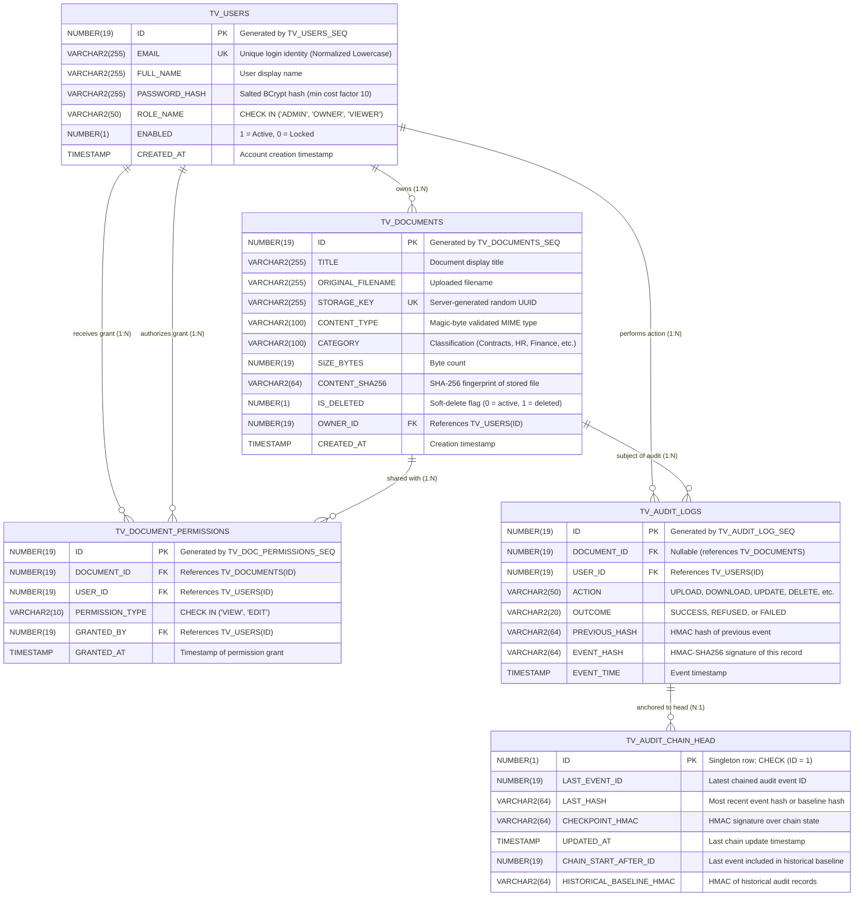
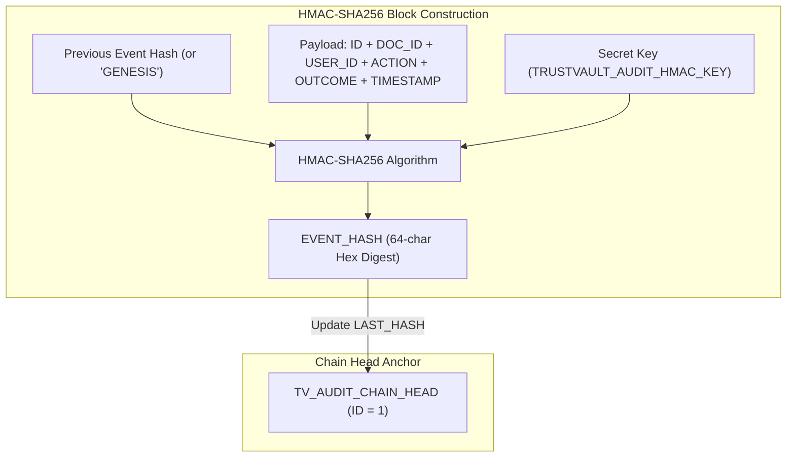

# Docurithm — Database Architecture & Schema Specification

<p align="center">
  
  
  
  
</p>

---

## Table of Contents
```
- [Overview \& Security Architecture](#-overview--security-architecture)
- [Entity-Relationship Diagram (ERD)](#-entity-relationship-diagram-erd)
- [Complete Data Dictionary](#-complete-data-dictionary)
  - [1. TV_USERS (User Identity \& Persona)](#1-tv_users-user-identity--persona)
  - [2. TV_DOCUMENTS (Document Metadata \& Storage Reference)](#2-tv_documents-document-metadata--storage-reference)
  - [3. TV_DOCUMENT_PERMISSIONS (Named Per-Document Access Grants)](#3-tv_document_permissions-named-per-document-access-grants)
  - [4. TV_AUDIT_LOGS (Cryptographically Chained Audit Ledger)](#4-tv_audit_logs-cryptographically-chained-audit-ledger)
  - [5. TV_AUDIT_CHAIN_HEAD (Cryptographic Blockchain Anchor)](#5-tv_audit_chain_head-cryptographic-blockchain-anchor)
- [Cryptographic Audit Chaining Architecture](#-cryptographic-audit-chaining-architecture)
- [Production Oracle SQL DDL Scripts](#-production-oracle-sql-ddl-scripts)
  - [Sequences](#sequences)
  - [Tables \& Constraints](#tables--constraints)
  - [Performance Indexes](#performance-indexes)
  - [Genesis Seed Execution](#genesis-seed-execution)
- [Verification Queries](#-verification-queries)

---

## Overview & Security Architecture

The Docurithm database stores **metadata, authorization grants, and cryptographic audit proofs**.
It is engineered according to core security principles:

1. **Separation of Concerns:** Sensitive document binary contents are **never** stored inside database BLOBs or public static folders. File bytes reside in an isolated, private vault storage directory referenced exclusively by a random server-generated UUID (`STORAGE_KEY`).
2. **Zero-Trust Relational Integrity:** Enforces referential integrity using explicit Foreign Keys with `ON DELETE` restrictions. Document deletion is handled via soft-deletes (`IS_DELETED = 1`) to preserve audit references.
3. **Immutable Tamper-Evident Audit Ledger:** The `TV_AUDIT_LOGS` table forms a sequential blockchain where each row contains an HMAC-SHA256 hash calculated over the current event payload concatenated with the previous row's hash.

---

## Entity-Relationship Diagram (ERD)



---

## Complete Data Dictionary

### 1. `TV_USERS` (User Identity & Persona)
Stores authenticated user credentials and baseline roles.

| Column Name | Data Type | Nullable | Constraints | Description |
|:---|:---|:---:|:---|:---|
| `ID` | `NUMBER(19)` | No | `PRIMARY KEY` | Unique user identifier (Sequence: `TV_USERS_SEQ`) |
| `EMAIL` | `VARCHAR2(255)` | No | `UNIQUE` | Login email address (case-insensitive lookup) |
| `FULL_NAME` | `VARCHAR2(255)` | No | None | User's full legal or display name |
| `PASSWORD_HASH` | `VARCHAR2(255)` | No | None | Salted BCrypt hash (never stores plaintext) |
| `ROLE_NAME` | `VARCHAR2(50)` | No | `CHECK IN ('ADMIN', 'OWNER', 'VIEWER')` | Persona determining administrative vs workspace capabilities |
| `ENABLED` | `NUMBER(1)` | No | `DEFAULT 1, CHECK (ENABLED IN (0, 1))` | Account lock status (0 disables login immediately) |
| `CREATED_AT` | `TIMESTAMP` | No | `DEFAULT CURRENT_TIMESTAMP` | Account provisioning timestamp |

---

### 2. `TV_DOCUMENTS` (Document Metadata & Storage Reference)
Stores document metadata. The actual binary content is kept on disk in private storage outside the webroot.

| Column Name | Data Type | Nullable | Constraints | Description |
|:---|:---|:---:|:---|:---|
| `ID` | `NUMBER(19)` | No | `PRIMARY KEY` | Document identifier (Sequence: `TV_DOCUMENTS_SEQ`) |
| `TITLE` | `VARCHAR2(255)` | No | None | Display title entered by user |
| `ORIGINAL_FILENAME`| `VARCHAR2(255)` | No | None | Sanitized filename supplied at upload time |
| `STORAGE_KEY` | `VARCHAR2(255)` | No | `UNIQUE` | Random UUID used to identify the file on disk |
| `CONTENT_TYPE` | `VARCHAR2(100)` | No | None | Validated MIME type (application/pdf, image/png, etc.) |
| `CATEGORY` | `VARCHAR2(100)` | No | `DEFAULT 'Uncategorized'` | Organizational category for search and filtering |
| `SIZE_BYTES` | `NUMBER(19)` | No | None | Exact file size in bytes |
| `CONTENT_SHA256` | `VARCHAR2(64)` | No | None | Cryptographic SHA-256 fingerprint of stored file |
| `IS_DELETED` | `NUMBER(1)` | No | `DEFAULT 0, CHECK (IS_DELETED IN (0, 1))` | Soft-delete flag (preserves audit foreign keys) |
| `OWNER_ID` | `NUMBER(19)` | No | `FOREIGN KEY -> TV_USERS(ID)` | User ID of the document creator |
| `CREATED_AT` | `TIMESTAMP` | No | `DEFAULT CURRENT_TIMESTAMP` | Upload timestamp |

---

### 3. `TV_DOCUMENT_PERMISSIONS` (Named Per-Document Access Grants)
Defines explicit read (`VIEW`) and modify (`EDIT`) permissions granted to specific users.

| Column Name | Data Type | Nullable | Constraints | Description |
|:---|:---|:---:|:---|:---|
| `ID` | `NUMBER(19)` | No | `PRIMARY KEY` | Permission ID (Sequence: `TV_DOC_PERMISSIONS_SEQ`) |
| `DOCUMENT_ID` | `NUMBER(19)` | No | `FOREIGN KEY -> TV_DOCUMENTS(ID)` | Target document |
| `USER_ID` | `NUMBER(19)` | No | `FOREIGN KEY -> TV_USERS(ID)` | Recipient user receiving access |
| `PERMISSION_TYPE`| `VARCHAR2(10)` | No | `CHECK IN ('VIEW', 'EDIT')` | Granted capability: `VIEW` (read/download) or `EDIT` |
| `GRANTED_BY` | `NUMBER(19)` | No | `FOREIGN KEY -> TV_USERS(ID)` | Owner or Administrator who authorized the grant |
| `GRANTED_AT` | `TIMESTAMP` | No | `DEFAULT CURRENT_TIMESTAMP` | Grant timestamp |

> **Uniqueness Constraint:** `UNIQUE (DOCUMENT_ID, USER_ID)` prevents duplicate permission grants.

---

### 4. `TV_AUDIT_LOGS` (Cryptographically Chained Audit Ledger)

Append-only log recording document activity and permission changes, including
successful and refused operations.

| Column Name | Data Type | Nullable | Constraints | Description |
|---|---|:---:|---|---|
| `ID` | `NUMBER(19)` | No | Primary key | Event ID; generated by `TV_AUDIT_LOG_SEQ` |
| `DOCUMENT_ID` | `NUMBER(19)` | No | Foreign key to `TV_DOCUMENTS(ID)` | Document associated with the event |
| `USER_ID` | `NUMBER(19)` | No | Foreign key to `TV_USERS(ID)` | User who performed the action |
| `ACTION` | `VARCHAR2(50)` | No | None | Event type, such as `DOCUMENT_DOWNLOAD` or `PERMISSION_GRANT` |
| `OUTCOME` | `VARCHAR2(20)` | No | None | Event outcome, such as `SUCCESS`, `DENIED`, or `FAILED` |
| `EVENT_TIME` | `TIMESTAMP` | No | Set by entity lifecycle callback | Time the event was created |
| `PREVIOUS_HASH` | `VARCHAR2(64)` | Yes | None | Hash linking the event to the preceding event |
| `EVENT_HASH` | `VARCHAR2(64)` | Yes | None | HMAC-SHA256 of the canonical event fields |
| `TARGET_USER_ID` | `NUMBER(19)` | Yes | No foreign key | ID snapshot of the user affected by a permission change |
| `TARGET_USER_EMAIL` | `VARCHAR2(320)` | Yes | None | Email snapshot of the affected user |
| `PREVIOUS_PERMISSION_TYPE` | `VARCHAR2(20)` | Yes | None | Permission before an update or revocation |
| `NEW_PERMISSION_TYPE` | `VARCHAR2(20)` | Yes | None | Permission after a grant or update |

The four `TARGET_*` and permission-type columns are nullable because ordinary
document events do not require permission-change metadata. No foreign key is
defined for `TARGET_USER_ID`, allowing historical audit evidence to retain
the recorded recipient ID after that account is deleted.

New permission events use the versioned HMAC calculation that includes the
permission metadata. Existing events without permission metadata retain the
original event-hash format.

### 5. `TV_AUDIT_CHAIN_HEAD` (Cryptographic Blockchain Anchor)
Singleton table maintaining the tip of the audit blockchain.

| Column Name | Data Type | Nullable | Constraints | Description |
|---|---|:---:|---|---|
| `ID` | `NUMBER(1)` | No | Primary key; `CHECK (ID = 1)` | Singleton chain-head row |
| `LAST_EVENT_ID` | `NUMBER(19)` | Yes | None | ID of the latest chained event or baseline event |
| `LAST_HASH` | `VARCHAR2(64)` | No | None | Hash at the current chain tip |
| `CHECKPOINT_HMAC` | `VARCHAR2(64)` | No | None | HMAC signature over chain state |
| `UPDATED_AT` | `TIMESTAMP` | No | Default current timestamp | Time the chain head was updated |
| `CHAIN_START_AFTER_ID` | `NUMBER(19)` | Yes | None | Last event included in the historical baseline |
| `HISTORICAL_BASELINE_HMAC` | `VARCHAR2(64)` | Yes | None | HMAC protecting the historical audit baseline |

---

## Cryptographic Audit Chaining Architecture



### Tamper-Evidence Mathematical Guarantee
If an attacker modifies any historical row $i$ in `TV_AUDIT_LOGS`:
1. The recalculated hash $\text{HMAC}(Row_i)$ will not match the stored `EVENT_HASH`.
2. Row $i+1$'s `PREVIOUS_HASH` will mismatch $\text{HMAC}(Row_i)$.
3. The chain verification walks from event 1 to head: any deletion, insertion, or column alteration triggers an integrity alert on `/api/admin/audit/integrity`.

---

## Production Oracle SQL DDL Scripts

Run the following scripts in your Oracle Database instance (`sqlplus` or Oracle SQL Developer) to create the schema from scratch:

### Sequences
```sql
CREATE SEQUENCE TV_USERS_SEQ START WITH 1 INCREMENT BY 1 NOCACHE;
CREATE SEQUENCE TV_DOCUMENTS_SEQ START WITH 1 INCREMENT BY 1 NOCACHE;
CREATE SEQUENCE TV_DOC_PERMISSIONS_SEQ START WITH 1 INCREMENT BY 1 NOCACHE;
CREATE SEQUENCE TV_AUDIT_LOG_SEQ START WITH 1 INCREMENT BY 1 NOCACHE;
```

### Tables & Constraints
```sql
-- 1. TV_USERS
CREATE TABLE TV_USERS (
    ID NUMBER(19) PRIMARY KEY,
    EMAIL VARCHAR2(255) NOT NULL UNIQUE,
    FULL_NAME VARCHAR2(255) NOT NULL,
    PASSWORD_HASH VARCHAR2(255) NOT NULL,
    ROLE_NAME VARCHAR2(50) NOT NULL,
    ENABLED NUMBER(1) DEFAULT 1 NOT NULL,
    CREATED_AT TIMESTAMP DEFAULT CURRENT_TIMESTAMP NOT NULL,
    CONSTRAINT CK_TV_USERS_ROLE CHECK (ROLE_NAME IN ('ADMIN', 'OWNER', 'VIEWER')),
    CONSTRAINT CK_TV_USERS_ENABLED CHECK (ENABLED IN (0, 1))
);

-- 2. TV_DOCUMENTS
CREATE TABLE TV_DOCUMENTS (
    ID NUMBER(19) PRIMARY KEY,
    TITLE VARCHAR2(255) NOT NULL,
    ORIGINAL_FILENAME VARCHAR2(255) NOT NULL,
    STORAGE_KEY VARCHAR2(255) NOT NULL UNIQUE,
    CONTENT_TYPE VARCHAR2(100) NOT NULL,
    CATEGORY VARCHAR2(100) DEFAULT 'Uncategorized' NOT NULL,
    SIZE_BYTES NUMBER(19) NOT NULL,
    CONTENT_SHA256 VARCHAR2(64) NOT NULL,
    IS_DELETED NUMBER(1) DEFAULT 0 NOT NULL,
    OWNER_ID NUMBER(19) NOT NULL,
    CREATED_AT TIMESTAMP DEFAULT CURRENT_TIMESTAMP NOT NULL,
    CONSTRAINT FK_TV_DOC_OWNER FOREIGN KEY (OWNER_ID) REFERENCES TV_USERS(ID),
    CONSTRAINT CK_TV_DOC_DELETED CHECK (IS_DELETED IN (0, 1))
);

-- 3. TV_DOCUMENT_PERMISSIONS
CREATE TABLE TV_DOCUMENT_PERMISSIONS (
    ID NUMBER(19) PRIMARY KEY,
    DOCUMENT_ID NUMBER(19) NOT NULL,
    USER_ID NUMBER(19) NOT NULL,
    PERMISSION_TYPE VARCHAR2(10) NOT NULL,
    GRANTED_BY NUMBER(19) NOT NULL,
    GRANTED_AT TIMESTAMP DEFAULT CURRENT_TIMESTAMP NOT NULL,
    CONSTRAINT FK_TV_PERM_DOC FOREIGN KEY (DOCUMENT_ID) REFERENCES TV_DOCUMENTS(ID),
    CONSTRAINT FK_TV_PERM_USER FOREIGN KEY (USER_ID) REFERENCES TV_USERS(ID),
    CONSTRAINT FK_TV_PERM_GRANTOR FOREIGN KEY (GRANTED_BY) REFERENCES TV_USERS(ID),
    CONSTRAINT UK_TV_DOC_USER_PERM UNIQUE (DOCUMENT_ID, USER_ID),
    CONSTRAINT CK_TV_PERM_TYPE CHECK (PERMISSION_TYPE IN ('VIEW', 'EDIT'))
);

-- 4. TV_AUDIT_LOGS
CREATE TABLE TV_AUDIT_LOGS (
    ID NUMBER(19) PRIMARY KEY,
    DOCUMENT_ID NUMBER(19),
    USER_ID NUMBER(19) NOT NULL,
    ACTION VARCHAR2(50) NOT NULL,
    OUTCOME VARCHAR2(32) NOT NULL,
CONSTRAINT CK_TV_AUDIT_OUTCOME
    CHECK (OUTCOME IN (
        'SUCCESS',
        'REFUSED',
        'FAILED',
        'DENIED',
        'INTEGRITY_UNAVAILABLE',
        'INTEGRITY_MISMATCH',
        'INTEGRITY_CHECK_ERROR'
    )),
    PREVIOUS_HASH VARCHAR2(64) NOT NULL,
    EVENT_HASH VARCHAR2(64) NOT NULL,
    EVENT_TIME TIMESTAMP DEFAULT CURRENT_TIMESTAMP NOT NULL,
    CONSTRAINT FK_TV_AUDIT_DOC FOREIGN KEY (DOCUMENT_ID) REFERENCES TV_DOCUMENTS(ID),
    CONSTRAINT FK_TV_AUDIT_USER FOREIGN KEY (USER_ID) REFERENCES TV_USERS(ID),
    
);

-- 5. TV_AUDIT_CHAIN_HEAD
CREATE TABLE TV_AUDIT_CHAIN_HEAD (
    ID NUMBER(1) PRIMARY KEY,
    LAST_EVENT_ID NUMBER(19),
    LAST_HASH VARCHAR2(64) NOT NULL,
    CHECKPOINT_HMAC VARCHAR2(64) NOT NULL,
    UPDATED_AT TIMESTAMP DEFAULT CURRENT_TIMESTAMP NOT NULL,
    CHAIN_START_AFTER_ID NUMBER(19),
    HISTORICAL_BASELINE_HMAC VARCHAR2(64),
    CONSTRAINT CK_TV_CHAIN_HEAD_SINGLETON CHECK (ID = 1)
);
```

### Performance Indexes
```sql
CREATE INDEX IDX_TV_DOC_OWNER ON TV_DOCUMENTS(OWNER_ID);
CREATE INDEX IDX_TV_DOC_CATEGORY ON TV_DOCUMENTS(CATEGORY);
CREATE INDEX IDX_TV_DOC_DELETED ON TV_DOCUMENTS(IS_DELETED);
CREATE INDEX IDX_TV_PERM_LOOKUP ON TV_DOCUMENT_PERMISSIONS(DOCUMENT_ID, USER_ID);
CREATE INDEX IDX_TV_AUDIT_DOC ON TV_AUDIT_LOGS(DOCUMENT_ID);
CREATE INDEX IDX_TV_AUDIT_TIME ON TV_AUDIT_LOGS(EVENT_TIME DESC);
```

### Genesis Seed Execution
```sql
INSERT INTO TV_AUDIT_CHAIN_HEAD (
    ID,
    LAST_EVENT_ID,
    LAST_HASH,
    CHECKPOINT_HMAC,
    UPDATED_AT,
    CHAIN_START_AFTER_ID,
    HISTORICAL_BASELINE_HMAC
) VALUES (
    1,
    NULL,
    'GENESIS',
    'UNINITIALIZED',
    CURRENT_TIMESTAMP,
    NULL,
    NULL
);

COMMIT;
```

---

## Verification Queries

### 1. Inspect Recent Audit Events with Integrity Signatures
```sql
SELECT
    ID,
    ACTION,
    OUTCOME,
    SUBSTR(PREVIOUS_HASH, 1, 12) || '...' AS PREV_HASH,
    SUBSTR(EVENT_HASH, 1, 12) || '...' AS CURR_HASH,
    EVENT_TIME
FROM TV_AUDIT_LOGS
ORDER BY ID DESC;
```

### 2. Verify Active Permissions Across Documents
```sql
SELECT
    d.TITLE,
    u.EMAIL AS RECIPIENT,
    p.PERMISSION_TYPE,
    g.EMAIL AS GRANTED_BY,
    p.GRANTED_AT
FROM TV_DOCUMENT_PERMISSIONS p
JOIN TV_DOCUMENTS d ON p.DOCUMENT_ID = d.ID
JOIN TV_USERS u ON p.USER_ID = u.ID
JOIN TV_USERS g ON p.GRANTED_BY = g.ID
WHERE d.IS_DELETED = 0;
```

#### Migration: Permission Audit Metadata

For an existing Oracle database, add the four nullable columns:

```sql
ALTER TABLE TV_AUDIT_LOGS ADD (
    TARGET_USER_EMAIL VARCHAR2(320),
    PREVIOUS_PERMISSION_TYPE VARCHAR2(20),
    NEW_PERMISSION_TYPE VARCHAR2(20)
);
ALTER TABLE TV_AUDIT_LOGS
    ADD CONSTRAINT CK_TV_AUDIT_OUTCOME
    CHECK (
    OUTCOME IN (
        'SUCCESS',
        'REFUSED',
        'FAILED',
        'DENIED',
        'INTEGRITY_UNAVAILABLE',
        'INTEGRITY_MISMATCH',
        'INTEGRITY_CHECK_ERROR'
    )
);

## Supabase PostgreSQL schema for the hosted demo

The Render production profile uses a **new, separate Supabase PostgreSQL database**. It does not connect to, copy, or modify the local Oracle `DATABASE` schema. For a fresh Supabase project, open its SQL Editor and run [`../supabase/schema.sql`](../supabase/schema.sql) exactly once. That script creates Docurithm's application tables, sequences, indexes, constraints, and the singleton audit-chain-head row. It must not be run against Oracle. After the script has run, the production profile uses `spring.jpa.hibernate.ddl-auto=validate` to check the schema rather than modifying it at application startup.

Hosted private document bytes are stored in the private `docurithm-private` Supabase Storage bucket through the Storage API. The SQL schema stores only each object's random UUID key, metadata, owner/permissions, and SHA-256 fingerprint. Do not manually insert or delete object metadata in Supabase's internal `storage` schema.
